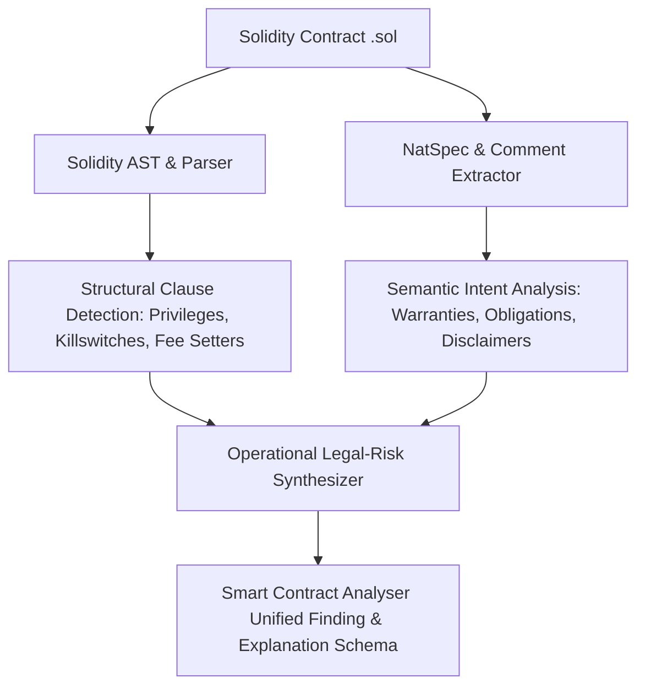
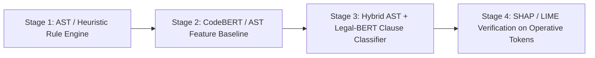

# Smart Contract Analyser — Analysis Specification & API Contract

**Document Version**: 1.0.0  
**Status**: Draft for Review  
**Target Milestone**: Analysis Definition Step (Pre-Backend & Pre-Modeling)  
*(Note: Earlier project working drafts referenced this system as "X-LegalContract")*

---

## 1. Confirmed Current State & Architecture Gap Analysis

### 1.1 Verified Codebase Assets
Following inspection of the frontend implementation and codebase architecture, the following assets are confirmed operational:

- **Frontend Application Stack**: React 19 + Vite 8 + Tailwind CSS v4 (`@tailwindcss/vite`) + React Router v7 + Lucide React + Recharts.
- **Implemented Views (10 Routes)**:
  - `Landing.jsx` (`/`): Public product landing with interactive split-pane preview.
  - `Login.jsx` (`/login`) & `Register.jsx` (`/register`): Authentication views with disclaimer checkboxes.
  - `Dashboard.jsx` (`/dashboard`): KPI cards and risk distribution charts.
  - `NewAnalysis.jsx` (`/analysis/new`): Solidity paste/upload interface with an 8-stage progress tracker.
  - `AnalysisResult.jsx` (`/analysis/:id`): Tabbed audit view (Solidity Code Viewer, SHAP chart, LIME highlights, Recommendations).
  - `History.jsx` (`/history`), `Reports.jsx` (`/reports`), `Profile.jsx` (`/profile`), `Settings.jsx` (`/settings`).
- **Existing Risk Constants (`src/utils/constants.js`)**:
  - `RISK_CATEGORIES`: `['Privacy', 'Termination', 'Legal Compliance', 'Liability', 'Payment / Financial']`
  - `RISK_LEVELS`: `'Low'`, `'Medium'`, `'High'`, `'Critical'`
  - `PIPELINE_STAGES`: 8 stages (*Uploading*, *Preprocessing*, *Tokenizing*, *Running AI*, *Classifying*, *Generating explanations*, *Generating recommendations*, *Preparing report*).
- **Existing Data Schemas (`src/data/mockData.js`)**:
  - `mockContracts` objects contain: `id`, `name`, `sourceCode`, `riskScore`, `riskLevel`, `riskBreakdown`, `findings`, `shapValues`, `limeExplanations`, `recommendations`.

### 1.2 Identified Differences Between Architecture Walkthrough & Current State
1. **Model Pipeline**: The original proposal references a live Legal-BERT, SHAP, and LIME inference pipeline. In reality, **no backend, no model weights, and no real inference scripts exist**. The frontend pipeline is entirely simulated in `NewAnalysis.jsx` via `setInterval` stepping through static data in `mockData.js`.
2. **Backend Services**: `src/services/api.js` is an uninvoked placeholder returning hardcoded values.
3. **Database & Storage**: No database or persistence exists; contract history and reports are static objects.
4. **Name Alignment**: The project is officially designated as **Smart_Contract_Analyser** across codebase constants (`constants.js`), package metadata (`package.json`), and documentation. Earlier working drafts that explored the title "X-LegalContract" have been normalized to this official designation.

---

## 2. Defined MVP Analysis Scope

### 2.1 The Core Distinction: Legal Risk vs. Security Auditing

| Dimension | Technical Smart-Contract Security (Slither, Mythril, CertiK) | Operational Legal-Risk Analysis (Smart Contract Analyser) |
|---|---|---|
| **Primary Objective** | Prevent unintended execution exploits and vulnerabilities. | Prevent regulatory non-compliance, contractual invalidity, and unfair terms. |
| **Target Hazards** | Reentrancy, integer overflows, unchecked return values, oracle manipulation, gas limit denial-of-service. | Unilateral asset forfeiture, arbitrary fee escalation, lack of user exit mechanisms, on-chain PII storage violating privacy laws, punitive liquidated damages. |
| **Execution State** | Code executes *erroneously* (bug / exploit). | Code executes *perfectly as written*, but produces **legally actionable harm** or unenforceability. |
| **Governing Rules** | EVM semantics, Solidity execution safety. | Consumer protection directives, GDPR/privacy statutes, general contract law principles. |

### 2.2 Input Formulation for the MVP
Smart contract source code is written in an imperative programming language (Solidity). Legal-BERT was pre-trained exclusively on natural language legal documents (statutes, judicial rulings, commercial contracts). 

**Feeding raw Solidity syntax into vanilla Legal-BERT produces a severe representation mismatch.**

#### Defensible MVP Scope: Paired Structural Logic + Semantic Comments
For the MVP, Smart Contract Analyser will analyze **Solidity Source Code (.sol)** by decomposing it into two complementary representations:

1. **Structural Logic (AST & Operational Modifiers)**:
   - Evaluates function visibility, state modifications, administrative modifiers (`onlyOwner`, `hasRole`), and privileged functions (`selfdestruct`, paused states, fee-setters, blacklists).
2. **Semantic Intent (NatSpec Annotations & Inline Comments)**:
   - Evaluates natural language developer statements (`@notice`, `@dev`, `@param`, `@custom:legal`) describing rights, warranties, and obligations.



**Rationale**: This is the only defensible scope because legal obligations require evaluating *what the contract claims to do* (NatSpec / terms) against *what the code actually permits administrators to do* (AST execution logic).

---

## 3. Risk Taxonomy Review & Proposed Refinements

The existing frontend defines 5 risk categories in `src/utils/constants.js`. Below is the formal review, operational definition, and refinement plan.

### 3.1 Taxonomy Review Table

| Category (Existing) | Operational Definition in Solidity Context | High-Risk Code/NatSpec Patterns | Status & Recommendations |
|---|---|---|---|
| **`Termination`** | Unilateral, unconstrained mechanisms that terminate contract operation, freeze assets, or exclude participants without due process or refund mechanisms. | `selfdestruct(owner)` without refund logic; indefinite pause without timelock; unappealable address blacklisting. | **Retain as core category**. AST detection is unambiguous and legally severe. |
| **`Payment / Financial`** | Unilateral alteration of financial terms, unconstrained fee hikes, or retention/confiscation of user deposits/staked assets. | Owner-controlled `setFee(uint256)` without an immutable upper bound; withdrawal functions lacking re-entrancy guarantees or imposing arbitrary deduction penalties. | **Retain as core category**. Clearly grounded in financial consumer protection. |
| **`Privacy`** | Permanent storage of Personally Identifiable Information (PII) on public immutable state slots, creating irremediable statutory violations. | State variables storing plaintext identifiers (e.g., `string public email`, `string public physicalAddress`, unhashed KYC attributes). Friction with GDPR Article 17 ("Right to Erasure"). | **Retain as core category**. Highly distinct from financial/technical concerns. |
| **`Liability`** | Disproportionate allocation of risk, punitive liquidated damages, or total disclaimers of administrative responsibility. | Slashing mechanisms exceeding 100% of collateral; NatSpec disclaiming gross negligence; non-reciprocal indemnification clauses embedded in contract docstrings. | **Retain as core category**. Focus on punitive forfeiture and unconstrained operator immunity. |
| **`Legal Compliance`** | **Identified Issue**: Too broad and inherently overlaps with all other categories (e.g., Privacy and Financial terms are also legal compliance issues). | Absence of mandatory withdrawal cooldowns; lack of dispute resolution address; failure to emit regulatory auditing events. | **Refine Definition (Do not rename in frontend)**: Restrict specifically to **"Statutory Disclosures & Governance Controls"** (e.g., multi-sig requirements, timelock governance, transparency disclosures). |

### 3.2 Severity Level Definitions

| Severity | Operational Criteria | Composite Score Impact |
|---|---|---|
| **`Critical`** | Immediate irreversible loss of user funds, total unilateral killswitch without recourse, or clear statutory breach (e.g., direct plaintext PII on-chain). | 85 – 100 |
| **`High`** | Unconstrained parameter modification (e.g., fee setter without ceiling), indefinite freeze power without timelock, or unconstrained slashing. | 65 – 84 |
| **`Medium`** | Imbalanced contractual terms, lack of multi-sig oversight for key administrative functions, or ambiguous NatSpec terms. | 40 – 64 |
| **`Low`** | Minor transparency gaps, missing NatSpec documentation for privileged state variables, or informational governance notices. | 0 – 39 |

---

## 4. Shared Finding & API Response Specification

To ensure immediate compatibility with `AnalysisResult.jsx`, `CodeViewer.jsx`, `ShapChart.jsx`, and `RecommendationCard.jsx`, the API contract must adhere to this unified JSON structure.

### 4.1 Schema Definition (TypeScript Interface)

```typescript
export interface AnalysisResponse {
  analysisId: string;
  contractName: string;
  solidityVersion: string;
  status: 'completed' | 'failed' | 'partial';
  timestamp: string;
  
  // Aggregate Metrics
  riskScore: number; // 0 - 100
  riskLevel: 'Low' | 'Medium' | 'High' | 'Critical';
  riskBreakdown: {
    Privacy: number;
    Termination: number;
    'Legal Compliance': number;
    Liability: number;
    'Payment / Financial': number;
  };
  
  // Granular Findings
  findings: Finding[];
  
  // Explainability Layers
  shapValues: ShapTokenImpact[];
  limeExplanations: LimeTokenWeight[];
  
  // Remediation
  recommendations: Recommendation[];
  
  // Diagnostic Metadata
  metadata: {
    linesOfCode: number;
    parserWarnings: string[];
    analysisModelVersion: string;
    engineType: 'rule_ast_hybrid_v1' | 'transformer_legal_v1';
  };
  
  // Error handling if status === 'failed'
  error?: {
    code: string;
    message: string;
    details?: string;
  };
}

export interface Finding {
  id: string; // e.g., 'f-01'
  category: 'Privacy' | 'Termination' | 'Legal Compliance' | 'Liability' | 'Payment / Financial';
  severity: 'Low' | 'Medium' | 'High' | 'Critical';
  title: string;
  description: string;
  lineNumbers: number[]; // e.g., [18, 19, 20]
  snippet: string;
  evidenceSource: 'ast_pattern' | 'semantic_model' | 'heuristic';
  regulatoryCitation?: string;
}

export interface ShapTokenImpact {
  feature: string; // Token or code construct
  value: number;   // Attribution score
  impact: 'positive' | 'negative'; // positive = increases risk; negative = reduces risk
}

export interface LimeTokenWeight {
  token: string;
  weight: number; // Normalized weight (-1.0 to +1.0)
}

export interface Recommendation {
  findingId: string;
  title: string;
  category: string;
  severity: string;
  beforeCode: string;
  afterCode: string;
  rationale: string;
}
```

### 4.2 Realistic Illustrative JSON Response

```json
{
  "analysisId": "audit-2026-10-8821",
  "contractName": "EscrowSettlement",
  "solidityVersion": "^0.8.20",
  "status": "completed",
  "timestamp": "2026-10-21T12:00:00Z",
  "riskScore": 88,
  "riskLevel": "Critical",
  "riskBreakdown": {
    "Termination": 95,
    "Payment / Financial": 82,
    "Liability": 74,
    "Legal Compliance": 60,
    "Privacy": 15
  },
  "findings": [
    {
      "id": "f-01",
      "category": "Termination",
      "severity": "Critical",
      "title": "Unilateral Emergency Killswitch (`selfdestruct`)",
      "description": "The contract permits the deployer address to unilaterally destroy the contract instance, permanently wiping state and sweeping remaining contract balances to the owner without verification of counterparty settlement.",
      "lineNumbers": [18, 19, 20, 21],
      "snippet": "function emergencyKill() external onlyOwner {\n    selfdestruct(payable(owner));\n}",
      "evidenceSource": "ast_pattern",
      "regulatoryCitation": "Unfair Contract Terms Directive (Directive 93/13/EEC, Annex 1.f)"
    },
    {
      "id": "f-02",
      "category": "Payment / Financial",
      "severity": "High",
      "title": "Unconstrained Unilateral Fee Escalation",
      "description": "Fee setter lacks an immutable upper bound (cap). The administrator can alter the protocol fee rate up to 100% at any time without notice or timelock delay.",
      "lineNumbers": [34, 35, 36],
      "snippet": "function setSettlementFee(uint256 newFeeBps) external onlyOwner {\n    settlementFeeBps = newFeeBps;\n}",
      "evidenceSource": "ast_pattern",
      "regulatoryCitation": "Consumer Rights Protection Regulations, Reg. 22"
    }
  ],
  "shapValues": [
    { "feature": "selfdestruct(payable(owner))", "value": 0.42, "impact": "positive" },
    { "feature": "onlyOwner modifier", "value": 0.28, "impact": "positive" },
    { "feature": "settlementFeeBps = newFeeBps", "value": 0.21, "impact": "positive" },
    { "feature": "require(msg.sender == owner)", "value": 0.15, "impact": "positive" },
    { "feature": "nonReentrant modifier", "value": -0.18, "impact": "negative" }
  ],
  "limeExplanations": [
    { "token": "selfdestruct", "weight": 0.88 },
    { "token": "owner", "weight": 0.54 },
    { "token": "settlementFeeBps", "weight": 0.41 },
    { "token": "onlyOwner", "weight": 0.38 },
    { "token": "nonReentrant", "weight": -0.22 }
  ],
  "recommendations": [
    {
      "findingId": "f-01",
      "title": "Deprecate `selfdestruct` in favor of a Multi-Sig Timelock and Escrow Recovery Vault",
      "category": "Termination",
      "severity": "Critical",
      "beforeCode": "function emergencyKill() external onlyOwner {\n    selfdestruct(payable(owner));\n}",
      "afterCode": "function initiateDecommission() external onlyTimelock {\n    require(totalLockedEscrow == 0, 'Active escrows pending');\n    isDecommissioned = true;\n    emit ContractDecommissioned(block.timestamp);\n}",
      "rationale": "Removes unilateral fund expropriation risk, ensuring participant funds cannot be swept arbitrarily."
    }
  ],
  "metadata": {
    "linesOfCode": 142,
    "parserWarnings": [],
    "analysisModelVersion": "0.1.0-mvp",
    "engineType": "rule_ast_hybrid_v1"
  }
}
```

---

## 5. Dataset Requirements & Annotation Specification

### 5.1 Unit of Analysis
- **Primary Annotation Unit**: **Function / Clause Block** within a Solidity smart contract, contextualized by its contract-level inheritance and state variables.
- **Aggregation Unit**: Whole **Contract Record** compiled from detected functional risks into composite scores.

### 5.2 Required Dataset Fields
1. `contract_id`: Unique identifier (e.g., `ETH-MAINNET-0x...` or `CURATED-001`).
2. `contract_name`: Name of primary contract.
3. `source_code`: Raw UTF-8 Solidity string.
4. `compiler_version`: Pragmas (e.g., `^0.8.20`).
5. `clauses`: Array of annotated clause units:
   - `clause_id`: Identifier.
   - `function_signature`: Target function or state variable.
   - `start_line` / `end_line`: Precise 1-indexed source location.
   - `ground_truth_category`: `Termination` | `Payment / Financial` | `Privacy` | `Liability` | `Legal Compliance` | `None`.
   - `ground_truth_severity`: `Low` | `Medium` | `High` | `Critical` | `Safe`.
   - `trigger_rationale`: Human annotator justification for legal risk.
   - `regulatory_reference`: Formal standard or statutory basis.
6. `annotator_metadata`: Credentials of annotator (legal engineer / smart contract auditor) and inter-annotator agreement score ($\kappa$).

### 5.3 Train / Validation / Test Split Strategy
- **Contract-Level Grouping**: Splitting must be executed strictly by **repository or deployer family**, never by random line or function sampling.
- **Rationale**: Smart contracts frequently reuse OpenZeppelin libraries and boilerplate code. Splitting randomly across functions from the same contract would cause catastrophic data leakage between train and test splits.
- **Recommended Ratio**: 70% Train / 15% Validation / 15% Test.

### 5.4 Realistic Status of Available Data
- **No off-the-shelf "Solidity Legal Risk" dataset exists**.
- Existing open datasets (SmartContract, SolidiFI, DefiHacks) are strictly labeled for runtime security flaws (reentrancy, integer bugs).
- **Action Required**: A curated gold-standard benchmark of 50–100 representative Solidity contracts representing standard decentralized finance (DeFi), token vesting, NFT sales, and escrow terms must be gathered and annotated according to this specification.

---

## 6. AI/ML Strategy Assessment & Recommended Model Sequence

### 6.1 Critical Assessment of Legal-BERT on Raw Solidity
1. **Vocabulary Fragmentation**: Legal-BERT’s tokenizer decomposes Solidity keywords (`address`, `uint256`, `selfdestruct`) into sub-word byte fragments (e.g., `['self', '##des', '##tr', '##uct']`), disrupting attention weights.
2. **Context Inversion**: In natural language legal contracts, rights and duties are stated via deontic modals (*"Party A shall not...", "The Operator warrants that..."*). In Solidity, duties are implicit within conditional checks (`require`, `revert`).
3. **Interpretability Grounding**: SHAP and LIME on a raw text model will highlight tokens that are merely frequent in code templates rather than legally operative constructs, unless the model is properly structured.

### 6.2 Recommended Evaluation Sequence



1. **Stage 1 — Deterministic AST / Heuristic Rule Baseline (Recommended First)**:
   - Construct a pure AST pattern-matching pipeline (using Python `solc-ast` or `tree-sitter-solidity`).
   - Detect hard operational violations: `selfdestruct`, unconstrained setters, plaintext string storage, absence of timelocks.
   - **Advantage**: 100% precision, zero hallucinations, instantaneous inference, immediately populates the frontend UI with real data.
2. **Stage 2 — Code-Aware Semantic Model**:
   - Evaluate a code-specific model (e.g., `microsoft/codebert-base` or `Salesforce/codet5-base`) to identify atypical privilege patterns.
3. **Stage 3 — Legal-BERT on Normalized Clause Summaries**:
   - Translate code constructs and NatSpec comments into standardized legal clause statements (e.g., *"Contract allows administrator to sweep funds without balance verification"*), and feed *that natural language summary* into Legal-BERT.
4. **Stage 4 — Explainability Validation**:
   - Measure whether SHAP and LIME token attributions actually point to the causative code tokens identified by the AST ground truth.

> **Crucial Disclaimer**: Model explanations (SHAP and LIME) represent mathematical evidence regarding which input features influenced the model’s internal weights. They do not constitute formal legal proof or validation.

---

## 7. Open Decisions for User Alignment

Before initiating implementation, the following decisions are documented for user alignment:

1. **MVP Scope Alignment**:
   - *Option A*: Adopt the **Hybrid AST + Operational Pattern** approach as Stage 1 (recommended). This provides immediate, mathematically verifiable findings for the frontend.
   - *Option B*: Pursue full Legal-BERT fine-tuning on raw Solidity immediately, acknowledging tokenizer fragmentation risks.
2. **Category Refinement for `Legal Compliance`**:
   - Agree to keep the key `'Legal Compliance'` in frontend data structures, but constrain its backend operational definition to *Statutory Disclosures, Governance Timelocks, and Dispute Resolution Mechanisms*.
3. **Data Curation Approach**:
   - Agree to compile a focused 25–50 contract initial evaluation suite (curated standard escrow, staking, and governance contracts) to benchmark the Stage 1 rule baseline before building deep learning pipelines.
