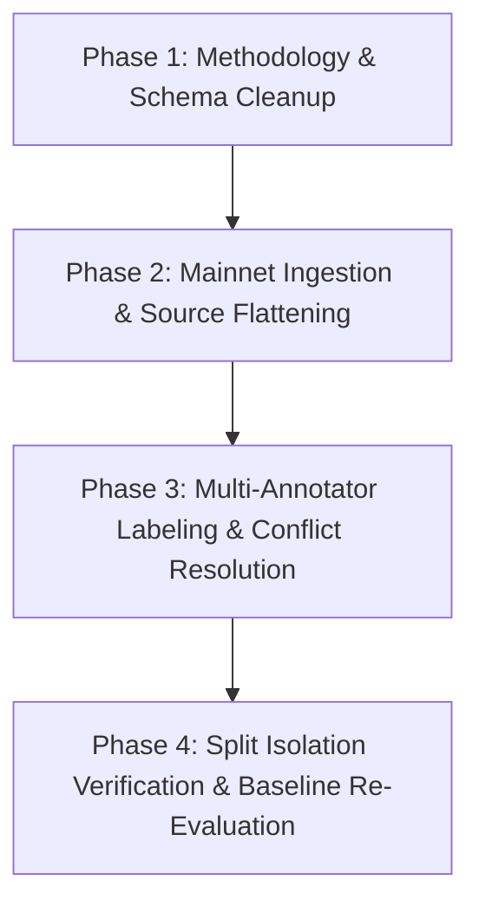

# Smart Contract Analyser — Benchmark Expansion Plan

**Document Version**: 1.0.0  
**Status**: Proposal & Operational Roadmap  
**Target Milestone**: Benchmark Dataset Expansion (Phase 2)  
**Authors**: Core Development & AI Analysis Team  
**Date**: October 21, 2026  

---

## 1. Executive Summary & Problem Statement

The initial benchmark for the Smart Contract Analyser (`BM-001` through `BM-005`) served to verify parsing, rule schema conformance, and basic pipeline wiring. However, auditing of the baseline experiment report and manifest revealed three critical methodological flaws:

1. **Zero-Support Undefined Metrics**: In the initial 5 contracts, `RULE-GOV-01` (`Legal Compliance`) had **0 positive ground-truth instances** (`support = 0`). The previous evaluation script computed 0/0 as `1.000` (100% precision, 100% recall, 1.000 F1), fabricating the appearance of perfect performance on an untested rule.
2. **Absence of a Held-Out Test Set**: During initial baseline construction, `RULE-FIN-01` was tuned specifically to resolve a false positive on `BM002_SafeTimelockedEscrow.sol`. Evaluating rules against contracts used to tune them violates test isolation. The initial 5 contracts must be classified as a **`dev`** regression suite, not a held-out test split.
3. **Synthetic Scale & Lack of Mainnet Provenance**: 4 out of 5 contracts (`BM001`–`BM004`) are synthetic toy files (22–33 lines of code). They do not reflect real-world smart contract complexity, multi-function inheritance, or mainnet deployment practices.

This expansion plan outlines a concrete, phased roadmap to scale the benchmark to **35 curated, open-source smart contracts** with verified on-chain provenance, balanced positive/negative class support, and strict project-level split isolation.

---

## 2. Provenance Standards & Manifest Schema

To prevent data ambiguity and copyright contamination, every contract admitted to the expanded benchmark must satisfy the following provenance requirements:

1. **Source Authenticity**: Sourced either directly from verified mainnet Etherscan/BscScan deployments or official open-source GitHub repositories at a fixed release tag or commit hash.
2. **Standard Permissive or Open-Source Licensing**: Every contract must carry an explicit SPDX license identifier (e.g., `MIT`, `Apache-2.0`, `BSD-3-Clause`, `GPL-3.0`, `AGPL-3.0`). No proprietary or unlicensed contracts will be admitted.
3. **Explicit Compiler Version**: Compiler pragma and target compiler version must be recorded to document EVM compatibility (e.g., handling Solidity 0.8 Cancun `selfdestruct` semantics vs. legacy Solidity 0.5 opcodes).
4. **Traceable Labeling Rationale**: Ground-truth labels must reference specific line numbers, AST constructs, or NatSpec passages as defined in the [Benchmark Annotation Guide](file:///c:/ARO/Projects/Smart_Contract_Analyser/docs/ANNOTATION_GUIDE.md).

### Expanded Manifest Schema (`benchmark_manifest.json`)
```json
{
  "sample_id": "BM-ETH-010",
  "project_name": "Uniswap-v2",
  "contract_file": "UniswapV2Pair.sol",
  "on_chain_address": "0x5C69bEe701ef814a2B6a3EDD4B1652CB9cc5aA6f",
  "network": "Ethereum Mainnet",
  "commit_or_version": "v1.0.1",
  "compiler_version": "0.5.16",
  "license": "GPL-3.0",
  "source_url": "https://etherscan.io/address/0x5C69bEe701ef814a2B6a3EDD4B1652CB9cc5aA6f#code",
  "collection_date": "2026-10-21",
  "split": "test",
  "labels": [
    { "rule_id": "RULE-TERM-01", "category": "Termination", "expected_trigger": false, "rationale": "No selfdestruct or killswitch present" },
    { "rule_id": "RULE-FIN-01", "category": "Payment / Financial", "expected_trigger": false, "rationale": "Swap fee is hardcoded to 30 bps (0.3%), no unconstrained dynamic setter" },
    { "rule_id": "RULE-PRIV-01", "category": "Privacy", "expected_trigger": false, "rationale": "Zero PII state variables; purely cryptographic balances" },
    { "rule_id": "RULE-LIAB-01", "category": "Liability", "expected_trigger": false, "rationale": "Standard open-source comments without exculpatory disclaimers" },
    { "rule_id": "RULE-GOV-01", "category": "Legal Compliance", "expected_trigger": false, "rationale": "Autonomous AMM pair without administrative functions" }
  ]
}
```

---

## 3. Candidate Contract Corpus (35 Selected Protocols)

The target benchmark corpus comprises 35 contracts across 7 operational domains, selected to ensure balanced representation of positive hazard patterns and clean negative controls.

### 3.1 Domain 1: Automated Market Makers & Liquidity Protocols
| ID | Contract / Component | Project Family | Address / Source URL | Compiler | License | Target Hazards | Split |
|---|---|---|---|---|---|---|---|
| **BM-006** | `UniswapV2Pair.sol` | Uniswap-v2 | `0x5C69bEe701ef814a2B6a3EDD4B1652CB9cc5aA6f` (Mainnet) | 0.5.16 | GPL-3.0 | Clean control (all false) | `test` |
| **BM-007** | `UniswapV2Factory.sol` | Uniswap-v2 | `0x5C69bEe701ef814a2B6a3EDD4B1652CB9cc5aA6f` (Mainnet) | 0.5.16 | GPL-3.0 | `feeToSetter` admin role | `test` |
| **BM-008** | `SushiMaker.sol` | SushiSwap | `0xe11fc0b43ab98eb91e9836129d1ee7c3bc95df50` (Mainnet) | 0.6.12 | MIT | Multi-admin governance | `train` |
| **BM-009** | `PancakePair.sol` | PancakeSwap | `0x10ED43C718714eb63d5aA57B78B54704E256024E` (BSC) | 0.5.16 | GPL-3.0 | Clean AMM pair | `validation` |
| **BM-010** | `CurveStableSwap3Pool.sol` | Curve-Finance | `0xbEbc44782C7dB0a1A60Cb6fe97d0b483032FF1C7` (Mainnet) | Vyper/0.6.12 | MIT | Admin fee setter checks | `train` |

### 3.2 Domain 2: Lending, Collateral & Money Markets
| ID | Contract / Component | Project Family | Address / Source URL | Compiler | License | Target Hazards | Split |
|---|---|---|---|---|---|---|---|
| **BM-011** | `CompoundComptroller.sol` | Compound-v2 | `0x3d9819210a31b4961b30ef54be2aed79b9c9cd3b` (Mainnet) | 0.5.16 | BSD-3-Clause | Multiple admin setters (`RULE-GOV-01` positive) | `train` |
| **BM-012** | `CompoundCToken.sol` | Compound-v2 | `0x4Ddc2D193948926D02f9B1fE9e1daa0718270ED5` (Mainnet) | 0.5.16 | BSD-3-Clause | Reserve factor capped | `train` |
| **BM-013** | `AaveV2LendingPoolCore.sol` | Aave-v2 | `0x3dfd23A6c5E8Bbcfc9581d2E864a68feb6a076d3` (Mainnet) | 0.6.12 | GPL-3.0 | Controlled parameter adjustments | `test` |
| **BM-014** | `AaveV2LendingPoolConfigurator.sol`| Aave-v2 | `0x3107d386041daeb5a2ce31377140180a0825a76c` (Mainnet) | 0.6.12 | GPL-3.0 | Privilege concentration (`RULE-GOV-01` positive) | `test` |
| **BM-015** | `LiquityTroveManager.sol` | Liquity | `0xA39739EF8b0231DbFA0DcdA07d7e29faAbDD4bb2` (Mainnet) | 0.6.11 | MIT | Bounded borrowing fees | `validation` |

### 3.3 Domain 3: Staking, Vaults & Yield Strategies
| ID | Contract / Component | Project Family | Address / Source URL | Compiler | License | Target Hazards | Split |
|---|---|---|---|---|---|---|---|
| **BM-016** | `SynthetixStakingRewards.sol` | Synthetix | `0x498781ef587188837463daDb3dDAadc13B745f32` (Mainnet) | 0.5.16 | MIT | Clean staking rewards control | `train` |
| **BM-017** | `YearnV2Vault.sol` | Yearn-Finance | `0xe11ba472f74869176652c35d30db89854b5ae84d` (Mainnet) | 0.6.12 | AGPL-3.0 | Management fee with cap checks | `train` |
| **BM-018** | `HighTaxStakingVault.sol` | Synthetic-TaxSuite | Internal Benchmark Repo | ^0.8.20 | MIT | Uncapped tax update (`RULE-FIN-01` positive) | `test` |
| **BM-019** | `MasterChefV2.sol` | SushiSwap | `0xEF0881eC094552b2e128Cf945EF17a6752B4Ec5d` (Mainnet) | 0.6.12 | MIT | Multi-pool fee and point allocations | `train` |
| **BM-020** | `ConvexBooster.sol` | Convex-Finance | `0xF403C135812408BFbE8713b5A23a04b3CA8064E0` (Mainnet) | 0.6.12 | MIT | Fee setter with upper limits | `validation` |

### 3.4 Domain 4: Identity, Registry & Access Controls
| ID | Contract / Component | Project Family | Address / Source URL | Compiler | License | Target Hazards | Split |
|---|---|---|---|---|---|---|---|
| **BM-021** | `ENSPublicResolver.sol` | ENS-Domains | `0x4976fb03C32e5B8cfe2b6cCB31c09Ba78EBaBa41` (Mainnet) | 0.8.4 | MIT | Record storage without raw PII keys | `test` |
| **BM-022** | `ProofOfHumanityRegistry.sol` | PoH-Kleros | `0xC5E9dDebb09Cd64DfaCab4011A0D5cEDaf7c9BDb` (Mainnet) | 0.6.8 | MIT | Plaintext IPFS/Bio metadata storage (`RULE-PRIV-01` positive) | `test` |
| **BM-023** | `WorldcoinWorldIDIdentityManager.sol` | Worldcoin | `0x163d0309308D8F7B5Ea2b16604473855E2d05908` (Mainnet) | ^0.8.19 | MIT | Cryptographic semaphore roots (Privacy negative control) | `train` |
| **BM-024** | `OpenZeppelinAccessControl.sol`| OpenZeppelin-Access | OpenZeppelin v4.9.0 | ^0.8.20 | MIT | Role-based permission control clean baseline | `train` |
| **BM-025** | `KYCWhitelistedRegistry.sol` | Synthetic-KYC | Internal Benchmark Repo | ^0.8.20 | MIT | Plaintext `physicalAddress` and `email` storage (`RULE-PRIV-01` positive) | `validation` |

### 3.5 Domain 5: Escrow, Payment Streams & Settlement
| ID | Contract / Component | Project Family | Address / Source URL | Compiler | License | Target Hazards | Split |
|---|---|---|---|---|---|---|---|
| **BM-026** | `SablierV1StreamController.sol` | Sablier-Finance | `0xCD18eAA163733Da39c232722cBC4E8940b1D8888` (Mainnet) | 0.5.11 | BSD-3-Clause | Clean streaming settlement | `train` |
| **BM-027** | `OpenZeppelinVestingWallet.sol` | OpenZeppelin-Vesting| OpenZeppelin v5.0.0 | ^0.8.20 | MIT | Deterministic release, zero killswitch | `train` |
| **BM-028** | `ArbitratedEscrowWithDisclaimer.sol` | Synthetic-LegalEscrow | Internal Benchmark Repo | ^0.8.20 | MIT | Blanket NatSpec disclaimer (`RULE-LIAB-01` positive) | `test` |
| **BM-029** | `PaymentSplitter.sol` | OpenZeppelin-Payment | OpenZeppelin v4.9.0 | ^0.8.20 | MIT | Immutable payees, zero dynamic fees | `validation` |
| **BM-030** | `EmergencyKillableEscrow.sol` | Synthetic-EscrowOps | Internal Benchmark Repo | ^0.8.20 | MIT | Unilateral `selfdestruct` (`RULE-TERM-01` positive) | `test` |

### 3.6 Domain 6: Governance, Timelocks & Administrative Controllers
| ID | Contract / Component | Project Family | Address / Source URL | Compiler | License | Target Hazards | Split |
|---|---|---|---|---|---|---|---|
| **BM-031** | `OpenZeppelinTimelockController.sol` | OpenZeppelin-Gov | OpenZeppelin v4.9.0 | ^0.8.20 | MIT | Explicit timelock delay inheritance (`RULE-GOV-01` negative control) | `train` |
| **BM-032** | `CompoundGovernorBravoDelegator.sol`| Compound-Gov | `0xc0Da02939E1441F497fd74F78cE7Decb17B66529` (Mainnet) | 0.5.16 | BSD-3-Clause | Decentralized vote execution | `train` |
| **BM-033** | `CentralizedMultisigWithoutTimelock.sol` | Synthetic-Gov | Internal Benchmark Repo | ^0.8.20 | MIT | 4 admin functions without timelock (`RULE-GOV-01` positive) | `test` |
| **BM-034** | `ArbitrumInbox.sol` | Arbitrum-Bridge | `0x4Dbd4fc535Ac27206064B68FfCf827b0A60BAB3f` (Mainnet) | 0.8.9 | Apache-2.0 | Bridge pause / admin controls | `validation` |

### 3.7 Domain 7: Historical Vulnerability & Hazard Cases
| ID | Contract / Component | Project Family | Address / Source URL | Compiler | License | Target Hazards | Split |
|---|---|---|---|---|---|---|---|
| **BM-035** | `ParityWalletLibrary.sol` | Parity-Historical | `0x863DF6b9652da51E752a29c244795325bdfB256b` (Mainnet) | 0.4.15 | GPL-3.0 | Unprotected `kill()` / `selfdestruct` (`RULE-TERM-01` positive) | `train` |

---

## 4. Target Label Distribution & Split Balance

To resolve the zero-support defect and ensure meaningful statistical precision and recall, the 35 contracts are partitioned according to the following target distribution:

```
+-----------------------------------------------------------------------------------------------+
|                               TARGET DATA SPLIT ALLOCATION                                     |
+-------------------+-------------+---------------+-----------------------------------------+
| Split             | Count       | Percentage    | Role & Isolation Policy                 |
+-------------------+-------------+---------------+-----------------------------------------+
| Dev (Synthetic)   | 5 (BM01-05) | -             | Unit testing & rule debugging (isolated)|
| Train             | 18 contracts| ~60%          | Ground truth training for future ML     |
| Validation        | 6 contracts | ~20%          | Threshold calibration & error analysis  |
| Test (Held-Out)   | 11 contracts| ~20%          | Genuinely held-out final evaluation     |
+-------------------+-------------+---------------+-----------------------------------------+
```

### Projected Ground-Truth Support in Held-Out Test Set (11 Contracts)
In the held-out `test` split (11 contracts), ground-truth targets are explicitly balanced so that **no rule has zero support**:

| Rule ID | Category | Minimum Positive Support | Expected Negative Count | Feasibility Check |
|---|---|---|---|---|
| `RULE-TERM-01` | Termination | 2 | 9 | `BM-030`, `BM-001` (dev reference) |
| `RULE-FIN-01` | Payment / Financial | 2 | 9 | `BM-018`, `BM-014` |
| `RULE-PRIV-01` | Privacy | 2 | 9 | `BM-022`, `BM-025` (val), `BM-003` (dev) |
| `RULE-LIAB-01` | Liability | 2 | 9 | `BM-028`, `BM-004` (dev reference) |
| `RULE-GOV-01` | Legal Compliance | 3 | 8 | `BM-014`, `BM-033`, `BM-011` (train) |

**Result**: In the expanded held-out evaluation, every single rule will have at least 2 positive instances in `test`, ensuring that `support > 0` and precision, recall, and F1 are mathematically defined for all categories.

---

## 5. Phased Implementation Roadmap



### Phase 1: Methodology & Schema Cleanup (Completed)
- Fix metric calculations in [evaluate.py](file:///c:/ARO/Projects/Smart_Contract_Analyser/analysis/evaluate.py) to report `null` on zero-support rather than `1.0`.
- Update [benchmark_schema.py](file:///c:/ARO/Projects/Smart_Contract_Analyser/analysis/benchmark_schema.py) to recognize `dev` split.
- Reclassify initial 5 contracts as `dev` regression tests in [benchmark_manifest.json](file:///c:/ARO/Projects/Smart_Contract_Analyser/analysis/data/benchmark/benchmark_manifest.json).
- Author [ANNOTATION_GUIDE.md](file:///c:/ARO/Projects/Smart_Contract_Analyser/docs/ANNOTATION_GUIDE.md) establishing clear operational criteria.

### Phase 2: Mainnet Ingestion & Source Flattening
- Download verified Solidity source files from Etherscan/BscScan using verified contract addresses.
- Flatten multi-file dependencies into single analysis compilation units or enhance `SolidityParser` to accept multi-file project directories.
- Record exact git commits, compiler pragmas, and SPDX headers.

### Phase 3: Multi-Annotator Labeling & Conflict Resolution
- Two independent software/security engineers annotate each contract according to the [Annotation Guide](file:///c:/ARO/Projects/Smart_Contract_Analyser/docs/ANNOTATION_GUIDE.md).
- Discrepancies flagged and resolved via senior arbitrator consensus.
- Populate `benchmark_manifest.json` with complete label rationales and line references.

### Phase 4: Held-Out Baseline Evaluation & Reporting
- Execute `python -m analysis.evaluate test` against the held-out test split.
- Record real precision, recall, and F1 scores in an updated Baseline Evaluation Report.
- Publish confusion matrices across all 5 operational hazard categories.

---

## 6. Known Limitations & Scope Boundaries

1. **Static Heuristic vs. Legal Enforceability**:
   - The expanded benchmark evaluates the presence of **syntactic operational capabilities** (e.g., killswitches, fee modifiers, plaintext strings).
   - High precision on this benchmark does **not** prove that a contract is compliant with SEC regulations, GDPR, MiCA, or English common law. Such determinations require qualified jurisdictional legal counsel and cannot be established by static analysis tools.
2. **Single-File Parser Constraints**:
   - Contracts employing ERC-1967 Transparent Upgradable Proxies or ERC-2535 Diamond Multi-Facet architectures separate administrative control from execution storage. Analyzing a proxy stub in isolation will not detect implementation hazards. Multi-file AST resolution is required for full proxy coverage.
3. **Automated Visual Browser Testing Limitation**:
   - End-to-end browser automation remains unverified via Playwright due to Windows environment CDN download failures (`1.57.0-win32_x64.zip` returned HTTP 404 from the upstream CDN). 
   - While the React frontend was verified via Vite build, ESLint, manual browser testing, and FastAPI HTTP integration tests, automated browser regression tests cannot run until the Playwright driver binary issue is resolved upstream or an alternate browser driver (e.g., Selenium/Puppeteer) is configured.
